# SKU-Fashion 系統介紹

SKU-Fashion 是一間服裝店的線上商店和管理系統，分成兩個網站：

- **Storefront（前台）**：給顧客用，網址從 `/` 開始。顧客在這裡挑衣服、選尺寸顏色、下單、付款、追蹤訂單。
- **Back-office（後台）**：給店裡的員工用，網址從 `/backoffice/` 開始。員工在這裡上架商品、管理庫存、處理訂單、看報表。

系統名稱裡的 SKU（Stock Keeping Unit，庫存單位）是整個設計的核心。同一件「Everyday Cotton Tee」有 3 種顏色、4 種尺寸，就是 12 個 SKU。每個 SKU 各自有庫存數量、可以各自加價。顧客買的是 SKU，庫存扣的也是 SKU。

| | |
|---|---|
| 後端 | Python 3.14、Django 6.1.2 |
| 資料庫 | PostgreSQL 17 |
| 畫面 | Django templates、Bootstrap 5.3。後台的視覺參考 AdminCN（shadcn/ui 風格） |
| 測試 | 119 個自動化測試 |

## 三種角色

| 角色 | 用哪個網站 | 能做什麼 |
|---|---|---|
| Customer（顧客） | 前台 | 自己註冊。購物、結帳、看和取消自己的訂單 |
| Staff（員工） | 後台 | 商品、庫存、促銷、運送、訂單、報表 |
| Admin（管理員） | 後台 | Staff 能做的全部，加上建立和管理員工帳號 |

用 Staff 或 Admin 登入時，系統會直接把你帶到後台。顧客如果直接輸入後台網址，會被擋下（HTTP 403）。

## 一筆訂單怎麼在兩邊之間流動

以銀行轉帳為例，前後台分工如下：

| 順序 | 誰 | 在哪 | 做什麼 | 訂單狀態 |
|---|---|---|---|---|
| 1 | 顧客 | 前台 | 選商品、結帳，選銀行轉帳 | Pending Payment |
| 2 | 顧客 | 前台 | 轉帳後在訂單頁上傳收據截圖 | Pending Payment |
| 3 | 員工 | 後台 | 對照收據金額和參考編號，按「Mark payment received」 | Paid |
| 4 | 員工 | 後台 | 開始備貨 | Preparing |
| 5 | 員工 | 後台 | 填物流公司和追蹤號碼，建立出貨單 | Shipped |
| 6 | 顧客 | 前台 | 在訂單頁看到追蹤號碼 | Shipped |
| 7 | 員工 | 後台 | 確認送達，完成訂單 | Completed |

選貨到付款（COD）的訂單跳過 1–3 步，下單後直接進入 Preparing，完成訂單時系統自動把付款標記為已收。

---

# Part 1：Storefront（前台）

## 1.1 首頁與商品列表

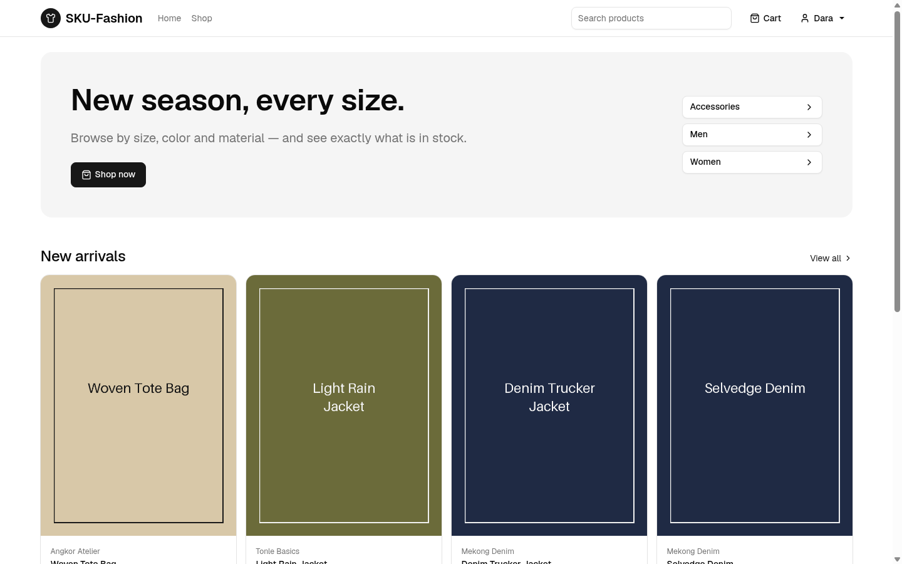

首頁列出最新上架的 8 件商品和頂層分類（Women / Men / Accessories）。

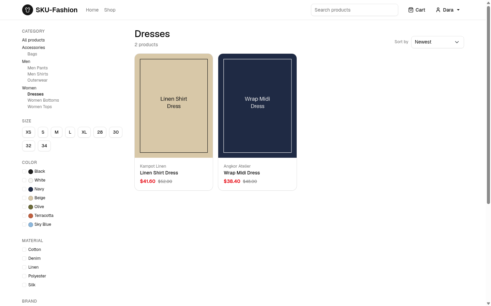

商品列表（`/shop/`）可以這樣找商品：

- **分類**：分類最多三層，例如 Women › Dresses。點上層分類會連同子分類的商品一起列出。
- **關鍵字**：搜尋商品名稱、描述、品牌和分類名稱。
- **篩選**：尺寸、顏色、材質、品牌、價格區間，可以疊加使用。篩選尺寸或顏色時，只會列出該尺寸或顏色**還有庫存**的商品。
- **排序**：最新、價格低到高、價格高到低、名稱。

正在活動中的商品會顯示原價劃線和活動價。

## 1.2 商品頁

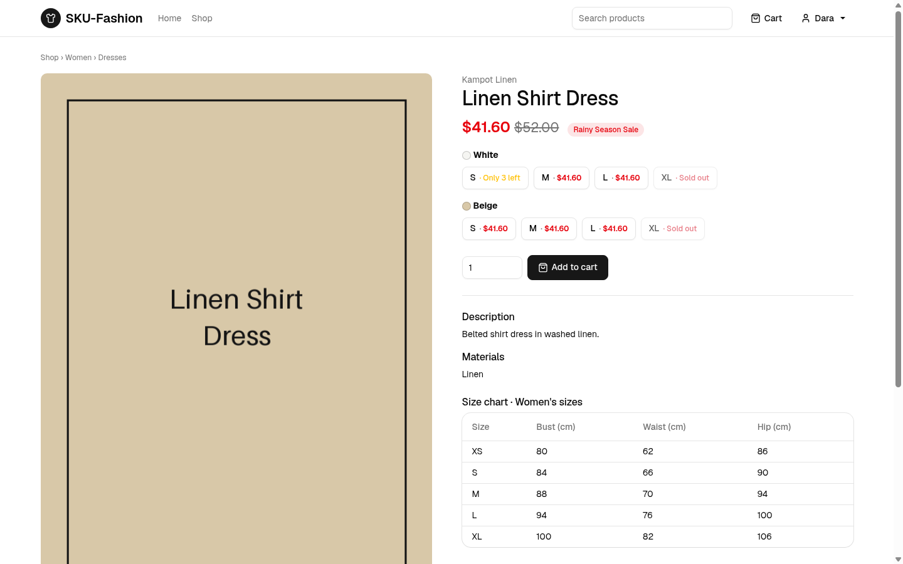

商品頁依顏色分組列出每個 SKU，每個尺寸直接標示狀態：

- 有庫存：顯示價格。
- 庫存低於安全量：顯示「Only 3 left」。
- 賣完：顯示「Sold out」，不能選。

下方是尺碼表。尺碼表綁在分類上，子分類會沿用上層分類的尺碼表：Dresses 沒有自己的尺碼表，所以顯示的是 Women 的。

## 1.3 購物車

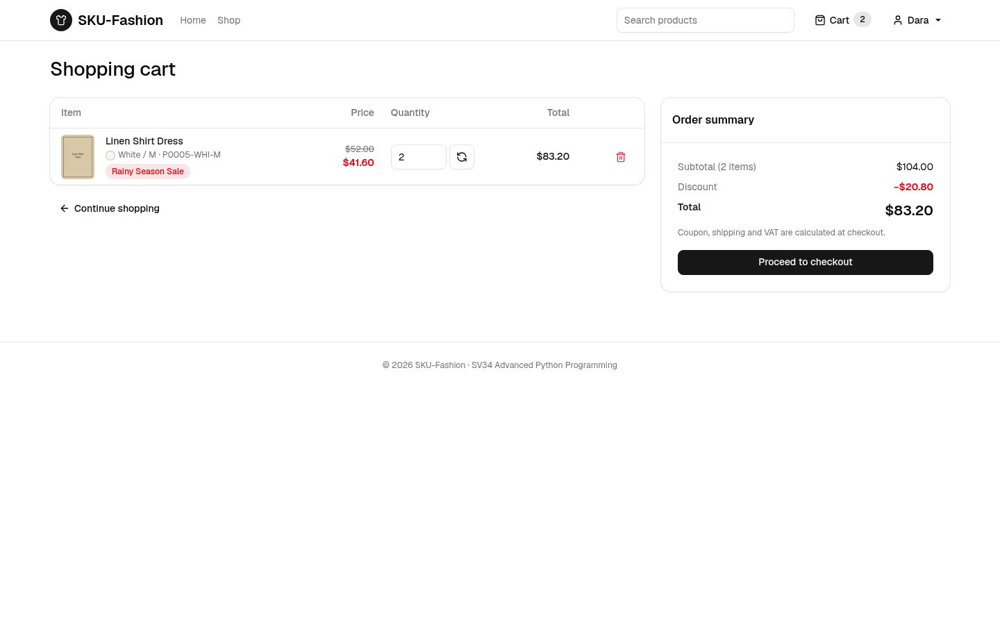

- **沒登入也能加購物車**，資料存在 session。登入後，訪客購物車會併入會員購物車。同一個 SKU 的數量相加，但不會超過庫存。
- 加入或修改數量時會檢查庫存，不能超買。
- 購物車只算商品小計和活動折扣。優惠券、運費和 VAT 在結帳頁才計算，因為這些要等選了地址和運送方式才知道。

## 1.4 結帳

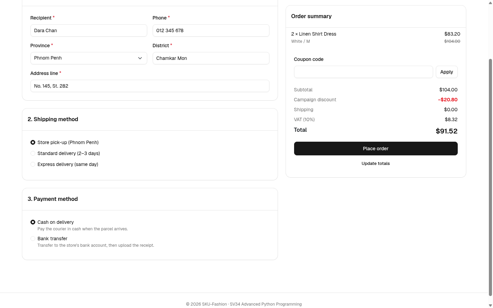

結帳頁分三步：

1. **收件資料**：可以從地址簿帶入。省份是柬埔寨 25 個省市的下拉選單。
2. **運送方式**：Store pick-up（運費 0）、Standard、Express。運費依序這樣決定：先看金額有沒有達到該方式的免運門檻，再看收件省份有沒有特別費率，都沒有就用基本運費。
3. **付款方式**：貨到付款或銀行轉帳。

右側的金額摘要計算順序：

```
小計 − 活動折扣 − 優惠券折扣 + 運費 + VAT 10%（算在折扣後的小計上）= 應付總額
```

優惠券不能用時，系統會說明原因，例如「已在某日過期」「最低消費是多少、你目前的商品總額是多少」「你已經用過這張券」「這張券已達使用上限」。

按下「Place order」後，系統在**一個資料庫交易**裡完成以下動作：再檢查一次庫存和價格、建立訂單和品項快照、扣庫存、建立付款紀錄、記錄優惠券使用。任何一步失敗就整筆取消，不會出現「扣了庫存卻沒有訂單」的狀況。兩個人同時搶最後一件時，只有一個人能成功下單。

## 1.5 我的訂單

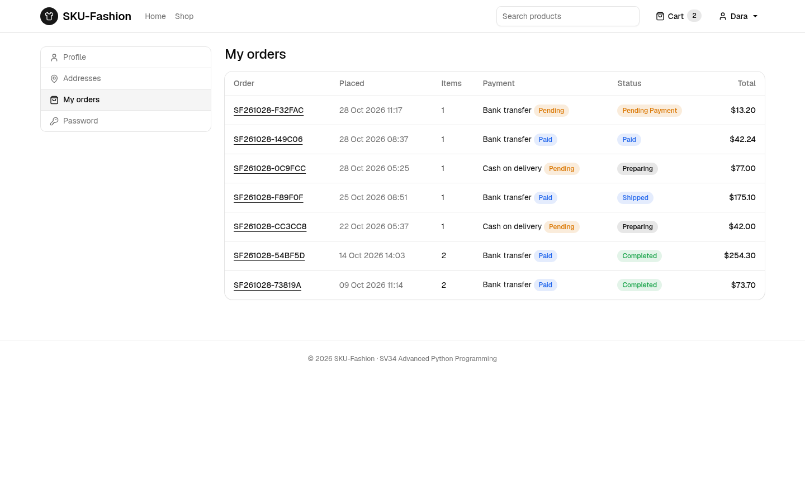


訂單詳情頁可以看到：

- 品項，以及下單當下的價格。之後商品改價也不影響已成立的訂單。
- 收件資料和運送方式。
- **狀態歷史**：每次狀態改變的時間和說明。
- **付款**：選銀行轉帳時，會顯示要轉到哪個帳戶、金額和參考編號，並提供上傳收據的表單。
- **出貨**：已出貨的訂單會顯示物流公司和追蹤號碼。
- **取消訂單**：出貨前可以取消。取消後庫存會加回去，用過的優惠券次數也會還回來。已付款的訂單取消後，會由員工處理退款。

銀行轉帳的訂單如果 **24 小時內沒有上傳收據**，系統會自動取消。已經上傳收據、只是員工還沒對帳的訂單不會被取消。

## 1.6 會員帳號

| 功能 | 說明 |
|---|---|
| 註冊、登入 | 用 email 登入。**連續輸錯 5 次密碼，帳號鎖 15 分鐘** |
| 個人資料、改密碼 | |
| 地址簿 | 可以存多個地址，並設定一個預設地址，結帳時自動帶入 |
| 我的訂單 | 見 1.5 |

忘記密碼目前沒有自助重設，要請 Admin 在後台發送重設連結。

---

# Part 2：Back-office（後台）

後台的版面參考 AdminCN：

- 左側是可以收合的側欄，右上角可以切換深色模式。
- 側欄有兩個數字徽章：**Orders** 顯示待處理的訂單數，**Stock levels** 顯示低庫存的 SKU 數。
- 「Back-office accounts」只有 Admin 看得到。

## 2.1 Dashboard

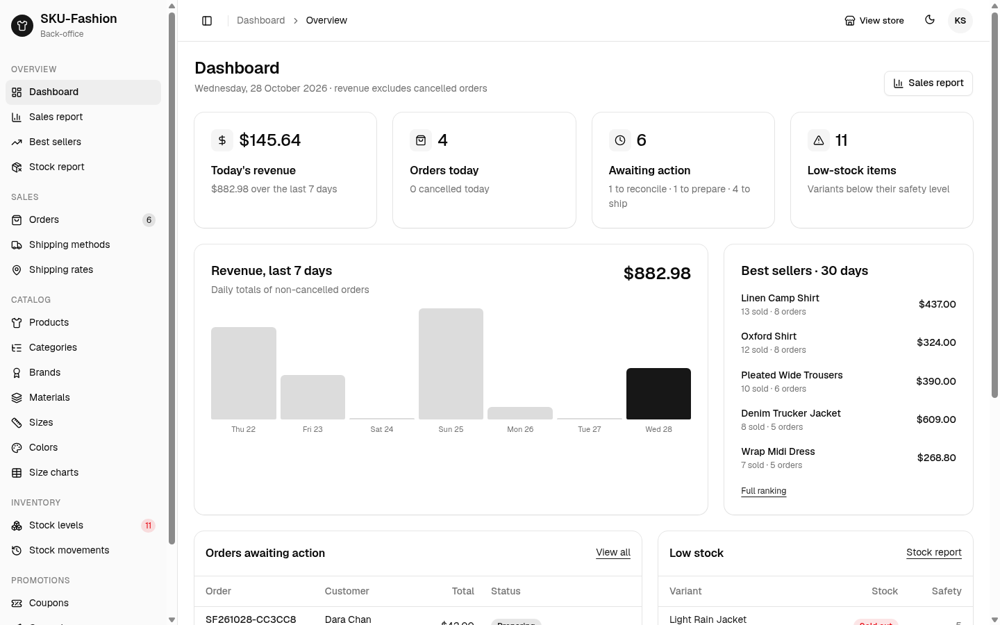

員工登入後第一眼看到的頁面：

- **四張統計卡**：今日營收、今日訂單數（含當日取消數）、待處理訂單（拆成待對帳、待備貨、待出貨）、低庫存 SKU 數。
- **近 7 天營收長條圖**，以及近 30 天暢銷前 5 名。
- **兩張表**：最早下單、還在等人處理的訂單，以及庫存最少的 SKU。點進去就能直接處理。

營收只計算未取消的訂單。

## 2.2 訂單管理

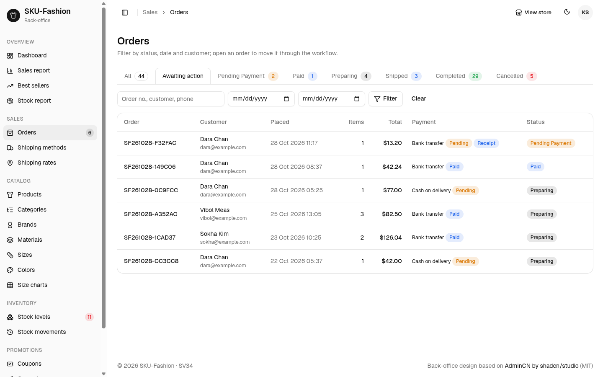

訂單列表上方有分頁標籤：全部、待處理，以及每個狀態各一個標籤，標籤上直接顯示筆數。列表可以用訂單編號、顧客姓名、email、電話和日期區間篩選。已上傳收據、等待對帳的訂單會多一個「Receipt」標記。

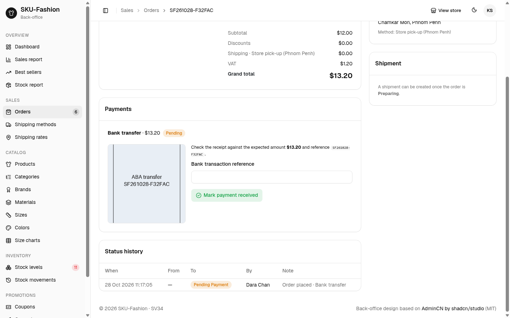

訂單詳情頁是後台最重要的頁面，訂單上所有的動作都在這裡完成：

| 動作 | 什麼時候能做 | 結果 |
|---|---|---|
| Mark payment received（對帳） | 銀行轉帳、已上傳收據 | 付款變為 Paid，記錄是哪位員工確認的和銀行交易編號；訂單變為 Paid |
| Mark Preparing | Paid | 開始備貨 |
| Create shipment | Preparing | 填物流公司和追蹤號碼，訂單變為 Shipped |
| Mark delivered | 已出貨 | 記錄送達時間 |
| Mark Completed | Shipped | 訂單完成；貨到付款的付款同時標記為已收 |
| Cancel order | 出貨前 | 庫存加回，優惠券次數還回 |
| Record refund | 付款已收 | 記錄退款金額和原因，退款總額不能超過實收金額 |

狀態只能照下面的路線走：

```
Pending Payment ──▶ Paid ──▶ Preparing ──▶ Shipped ──▶ Completed
       │             │           │
       └─────────────┴───────────┴──▶ Cancelled
```

試圖跳步（例如從 Pending Payment 直接到 Completed）會被擋下，並顯示目前可以走的下一步。每次狀態改變都會寫進狀態歷史，記錄時間、操作的人和備註。系統自動取消的訂單，操作者顯示為「System」。

## 2.3 商品目錄

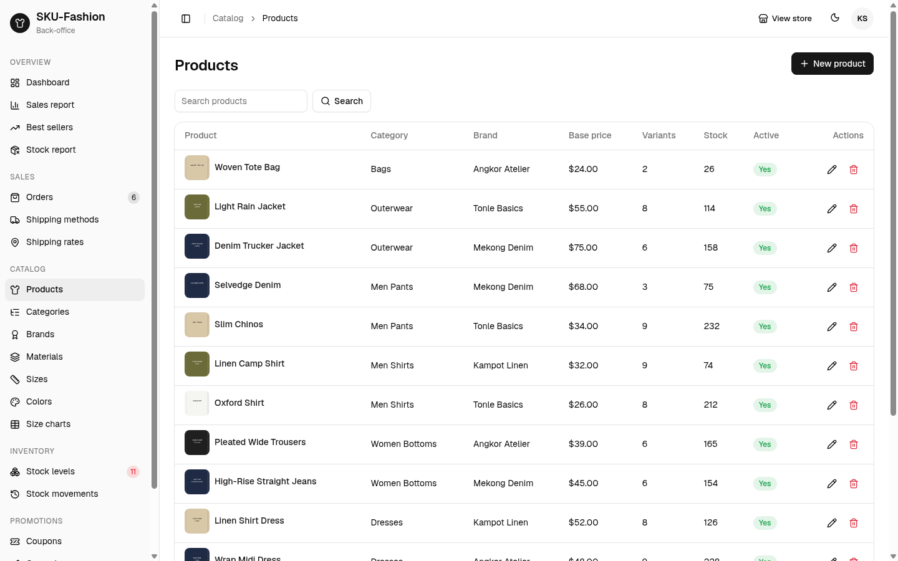

基本資料各有自己的管理頁：分類（最多三層）、品牌、材質、尺寸、顏色（含色碼）、尺碼表。

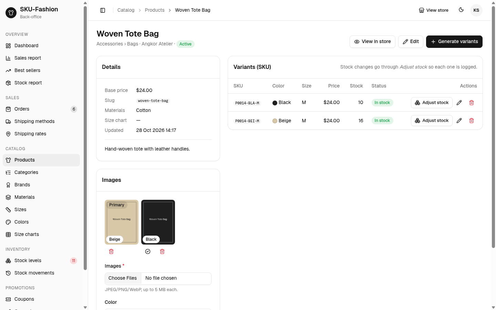

商品詳情頁集中了一件商品的所有資料：基本資料、每個顏色的圖片（可以指定主圖）和 SKU 列表。每個 SKU 都有「Adjust stock」按鈕。庫存只能從這個按鈕修改，不能直接在 SKU 的編輯表單裡改數字，這樣每次變動都會留下紀錄。

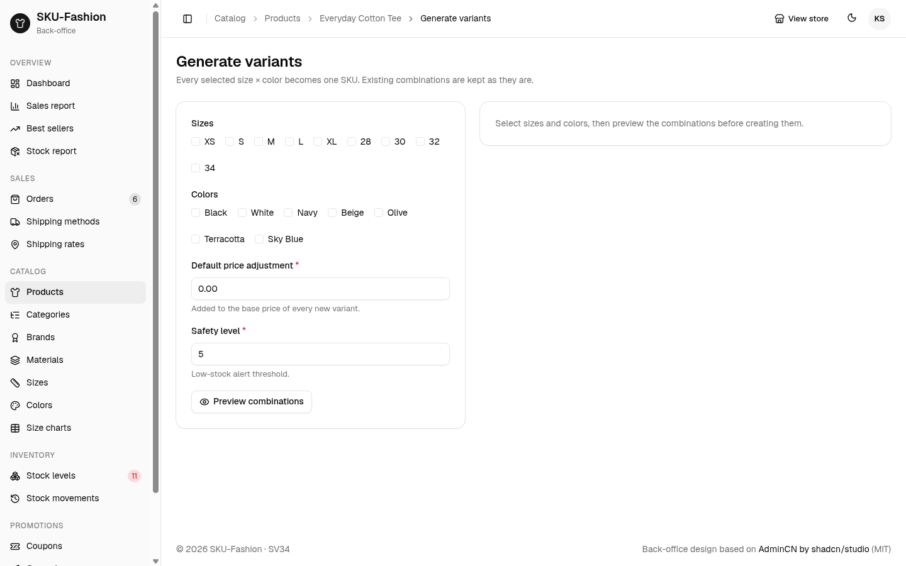

**批次產生 SKU**：勾選尺寸和顏色，系統先預覽所有組合，確認後一次建立。

- 已經存在的組合會跳過，不會重複建立。
- SKU 編號自動產生，格式是 `P{商品編號}-{顏色前 3 碼}-{尺寸}`，例如 `P0014-BLA-M`。

## 2.4 庫存

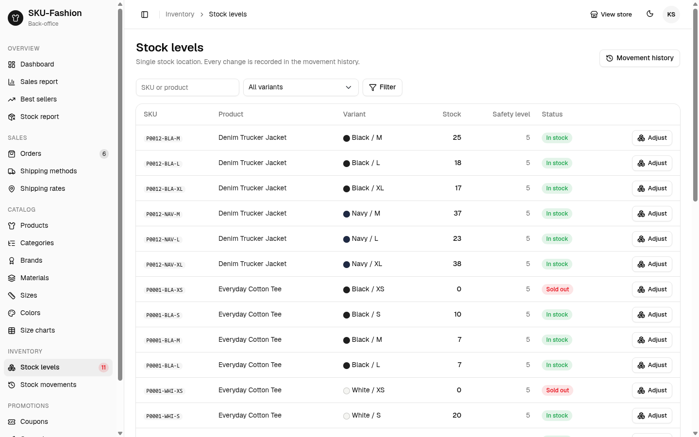

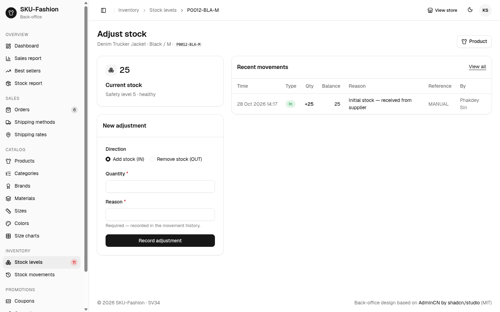

調整庫存時要選方向（入庫或出庫），並**一定要填原因**，例如「供應商到貨」或「瑕疵品報廢」。

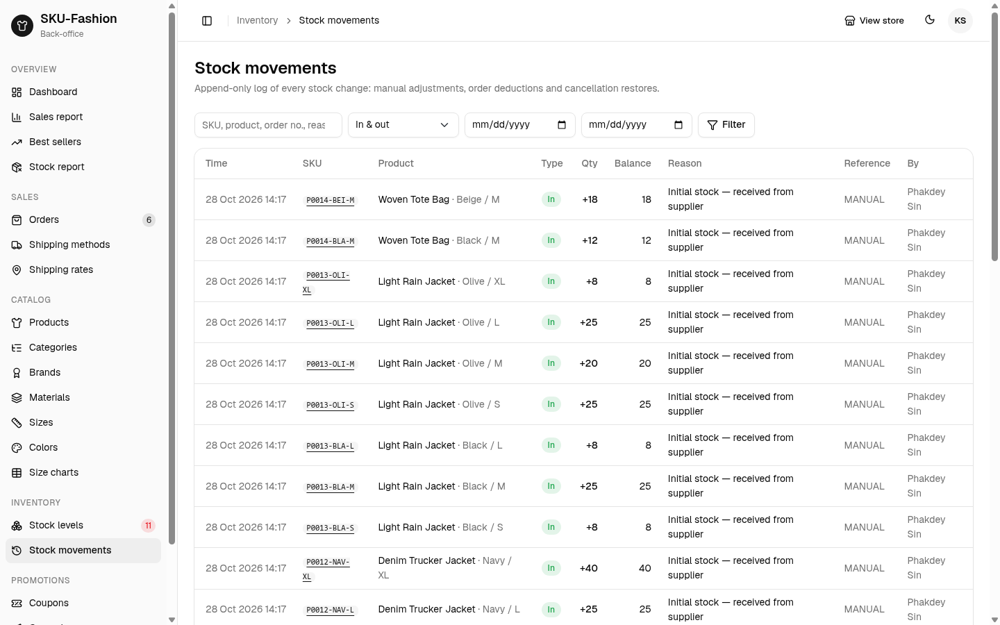

庫存異動紀錄列出每一次庫存變化：時間、類型、數量、變動後的結餘、原因、參考（訂單編號，或手動調整的 `MANUAL`）、操作人。顧客下單、取消訂單、員工手動調整都會寫進這張表，所以任何一個 SKU 的庫存數字都查得到來源。這張表只能新增，不能修改或刪除。

每個 SKU 都有安全量（預設 5）。庫存低於安全量時，SKU 會出現在低庫存警示、側欄徽章和庫存報表裡。

## 2.5 促銷

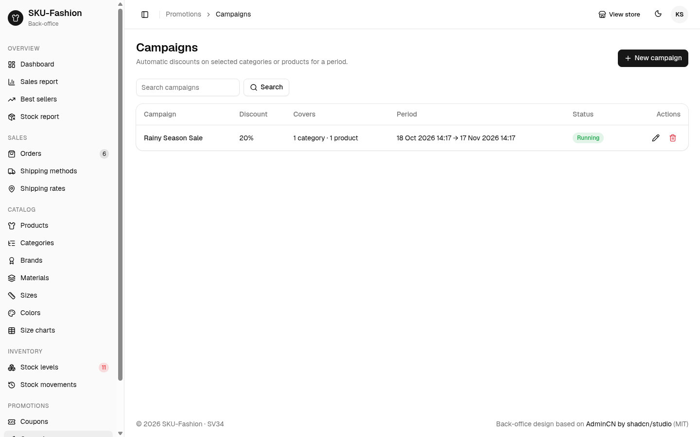

促銷分兩種：

| | Campaign（活動） | Coupon（優惠券） |
|---|---|---|
| 怎麼生效 | 自動。在期間內，指定分類或商品直接顯示活動價 | 顧客在結帳時輸入代碼 |
| 折扣 | 百分比或固定金額 | 百分比或固定金額 |
| 限制 | 期間 | 期間、最低消費、總使用次數、每人使用次數 |

一件商品同時符合多個活動時，系統自動採用折扣最多的那個。列表上依目前時間把每個活動標成 Running、Scheduled、Ended 或 Inactive。

## 2.6 運送

| 頁面 | 管理什麼 |
|---|---|
| Shipping methods | 運送方式、基本運費、免運門檻 |
| Shipping rates | 某運送方式在某個省份的特別運費，例如 Standard 寄 Phnom Penh 只收 $1.50 |

## 2.7 報表

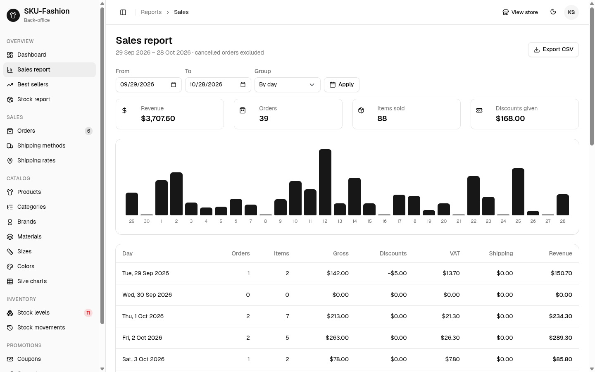

| 報表 | 內容 |
|---|---|
| Sales report | 選日期區間，按日或按月統計：訂單數、件數、商品總額、折扣、VAT、運費、營收。沒有銷售的日子也會列出來，顯示 0。可以匯出 CSV |
| Best sellers | 依賣出件數排名的商品，以及每件商品的訂單數和營收 |
| Stock report | 低於安全量和已賣完的 SKU，以及每個還差多少才回到安全量，旁邊有補貨按鈕 |

## 2.8 後台帳號（只有 Admin）

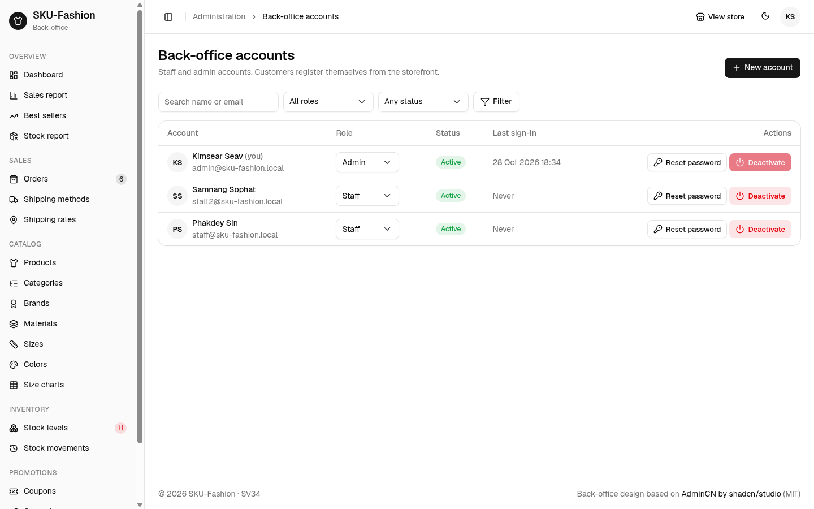

- **建立員工帳號**：Admin 不用替員工設密碼。系統寄出一個設定密碼的連結，3 天內有效。
- **其他操作**：改角色（Staff 或 Admin）、停用或啟用帳號、寄送重設密碼連結。
- **兩道防呆**：不能停用自己；系統至少要保留一個啟用中的 Admin，所以最後一個 Admin 不能被降級或停用。

開發環境沒有寄信伺服器，信件內容（包含連結）會印在執行 `runserver` 的終端機上。

---

# 附錄：上台示範路線

以下用示範資料（`python manage.py seed_demo`）走一遍，大約 8 分鐘。所有帳號的密碼都是 `Demo-Pass-2026`。

1. **前台，以訪客身分**：打開 Women › Dresses。指出「Rainy Season Sale」（洋裝打 8 折）的活動價，以及商品頁上的低庫存和「Sold out」標示。把一件商品加入購物車。
2. **登入** `dara@example.com`：購物車裡剛才加的商品還在，這是訪客購物車合併的結果。
3. **結帳**：選 Standard、銀行轉帳，輸入 `FIVEOFF`。這張券最低消費 $40，金額不夠時會看到最低消費的提示，可以順便示範。下單後上傳一張收據圖片。
4. **後台，換登入** `staff@sku-fashion.local`：Dashboard 的待處理數字多了 1。打開這筆訂單，依序按對帳、Preparing、建立出貨單（填追蹤號碼）。
5. **回到前台的 Dara**：訂單頁出現追蹤號碼，狀態歷史裡記著每一步的時間。
6. **後台的庫存異動**：找到這筆訂單編號對應的那筆扣庫存紀錄。
7. **後台的報表**：Sales report 匯出 CSV；Stock report 列出待補貨的 SKU。
8. **換登入** `admin@sku-fashion.local`：側欄多出「Back-office accounts」。試著停用自己，系統會擋下來。

示範前想把資料重置成初始狀態，可以執行：

```bash
python manage.py flush --no-input
rm -rf media/products media/receipts
python manage.py seed_demo
```
